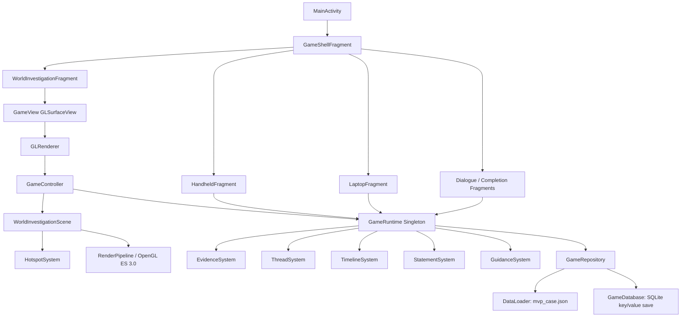
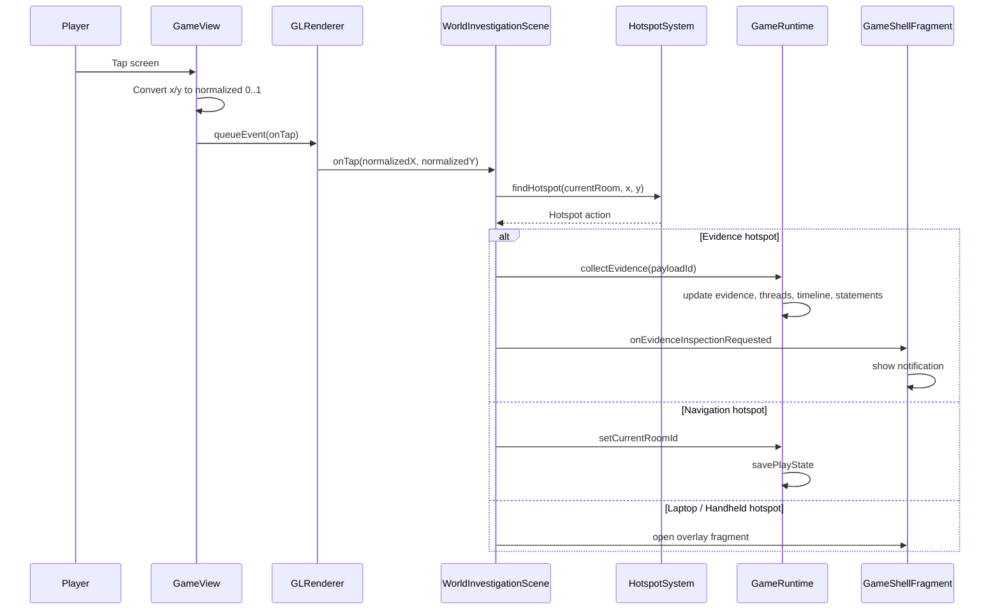
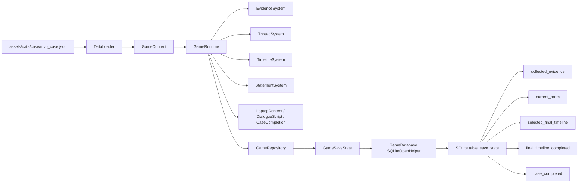
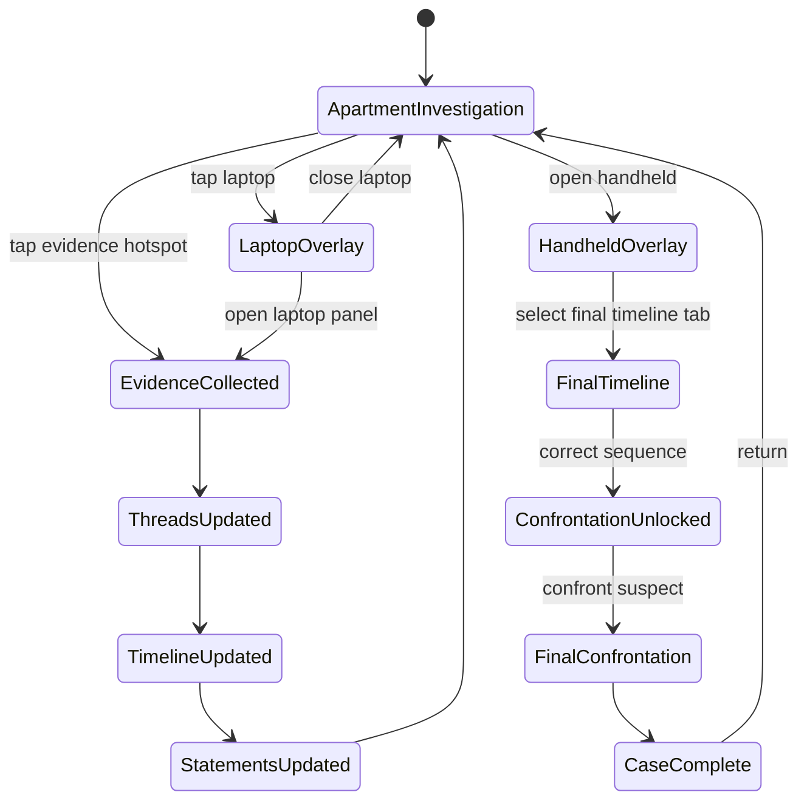
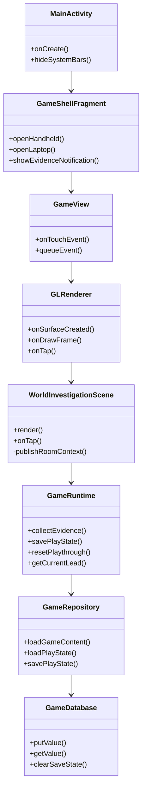

## Presentation Script

TraceRoute is an Android investigation game built in Java with Android Views, Fragments, SQLite, and OpenGL ES 3.0. The player investigates a fixed-scene apartment murder case by tapping room hotspots, collecting evidence, reading laptop records, reviewing a handheld forensic device, ordering the final timeline, and confronting the suspect.

The application starts in MainActivity, which stays intentionally thin. It initializes GameRuntime, initializes audio, enters fullscreen landscape mode, and hosts the root GameShellFragment. GameShellFragment acts as the UI shell: it contains the OpenGL world fragment and swaps overlay fragments such as the handheld and laptop.

The world view is rendered through GameView, a GLSurfaceView. Touch input starts as normal Android MotionEvent input, then gets normalized into 0..1 screen coordinates. That input is sent onto the OpenGL thread with queueEvent, then routed through GLRenderer, GameController, and WorldInvestigationScene. The scene asks HotspotSystem which hotspot was tapped and triggers actions like room navigation, evidence collection, opening the laptop, or opening the handheld.

The OpenGL side renders the apartment room backgrounds using RenderPipeline, Texture, TexturedQuad, and shader settings. The UI side remains Android Views and XML layouts, so the handheld, laptop, notifications, dialogue, and completion screens are separate from the OpenGL post-processing.

The central runtime is GameRuntime. It owns the major gameplay systems: evidence, investigation threads, timeline, suspect statements, guidance, room definitions, laptop content, final confrontation, and completion state. Static content is loaded from mvp_case.json through DataLoader, wrapped by GameRepository, and registered into these systems.

SQLite is used for save state through GameDatabase, backed by a compact key/value table. We save collected evidence IDs, current room, final timeline selection, final timeline completion, and case completion. Thread and statement states are mostly derived from collected evidence, which keeps the saved data small and consistent.

The main gameplay loop is data-driven: collecting evidence updates evidence state, then thread state, then timeline and statement state. The guidance system reads those systems and returns the next lead. The handheld exposes the current evidence, threads, timeline, statements, and final timeline ordering. The laptop exposes authored panels that unlock additional evidence. Once the final timeline is correct, the player can start the confrontation and reach the case completion screen.

## Technologies To Mention

Java, not Kotlin.
Android Activity, Fragment, XML layouts, and standard Android Views.
GLSurfaceView with OpenGL ES 3.0 for room rendering.
Shader-based room post-processing separate from Android UI.
JSON asset loading for authored case content.
SQLite via SQLiteOpenHelper for persistence.
Fragment overlays for handheld, laptop, dialogue, and completion.
JUnit unit tests for progression, content validation, hotspot behavior, settings, and save-state logic. 

## Graphs

